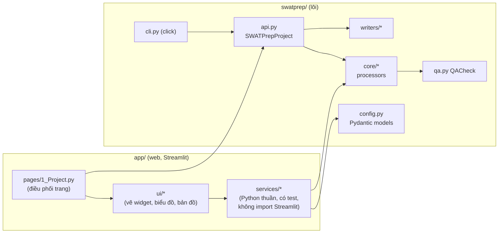
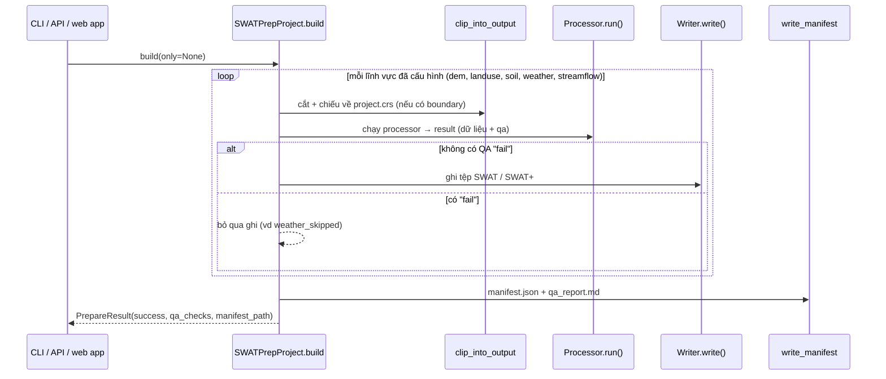
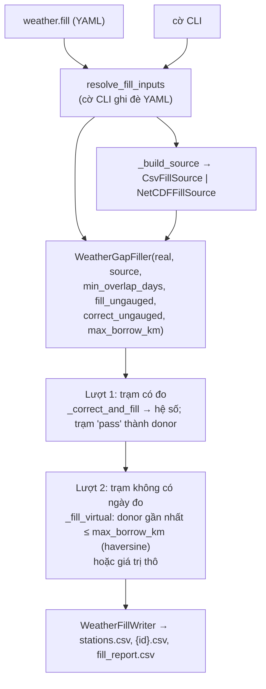
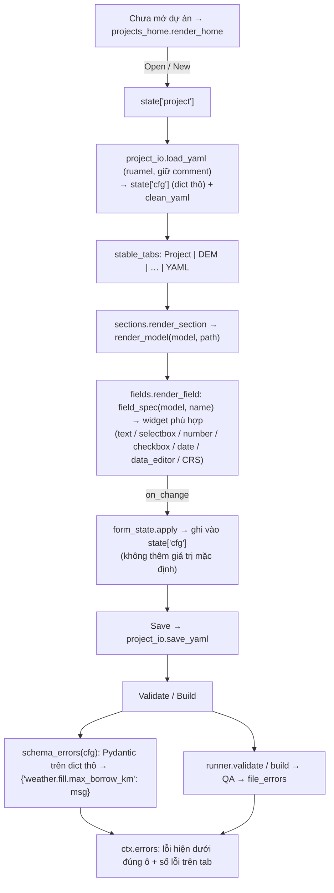
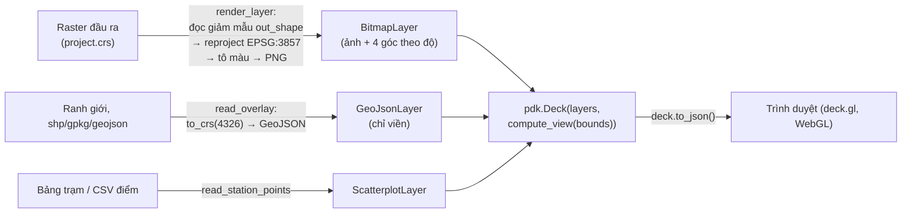

# Tài liệu học lại `swatprep` (v0.9.0): thư viện lõi, cách các chức năng kết nối, bản đồ và tối ưu

*Soạn ngày 03/11/2026 cho phiên bản 0.8.0, cập nhật cho 0.9.0 (mục 5.5: các tối ưu đã áp dụng). Mọi mã mẫu nằm trong [`docs/learning/`](learning/) và đã được chạy thử;
mọi số đo trong tài liệu lấy từ các script đó (máy Linux, Python 3.12, GDAL 3.12). Tài liệu ôn tập trước,
[`STUDY_NOTES_vi.md`](STUDY_NOTES_vi.md), đi sâu vào tối ưu lõi (fill NetCDF, đọc raster theo dải); tài liệu này
bao quát toàn hệ thống và web app.*

## 0. Cách dùng tài liệu

Mỗi phần trả lời bốn câu hỏi: **thành phần nào → kết nối với nhau ra sao → mã mẫu chạy được → bài học / cách tối ưu**.
Lộ trình đề nghị:

| Bước | Đọc | Chạy (từ thư mục gốc của kho mã) | Mục tiêu |
|---|---|---|---|
| 1 | Mục 1, 2 | | Nắm bản đồ mã và vai trò từng thư viện |
| 2 | Mục 3 | `uv run python docs/learning/01_api_build.py` · `02_processor_pattern.py` · `03_fill_virtual_station.py` | Hiểu luồng lõi: config → processor → QA → writer |
| 3 | Mục 4 | `uv run python docs/learning/04_form_from_model.py` | Hiểu web app sinh form từ model và nối với lõi |
| 4 | Mục 5 | `05_map_preview.py` · `uv run streamlit run docs/learning/06_map_select_app.py` · `07_optimize_map.py` | Hiểu bản đồ, tương tác và cách tối ưu |
| 5 | Mục 6, 7 | `uv run python -m pytest -q` | Kiểm thử và tự kiểm tra |

Cài môi trường một lần: `uv sync --extra geo --extra app --extra dev`.

---

## 1. Bản đồ tổng thể

### 1.1 Hai tầng, phụ thuộc một chiều



- **Lõi (`swatprep/`)** không biết gì về web: CLI, Python API và web app đều gọi cùng `SWATPrepProject`.
- **`app/services`** chứa logic của web app ở dạng Python thuần nên test được bằng `pytest` thường;
  **`app/ui`** chỉ vẽ; **`app/pages`** nối các phần lại. Chiều phụ thuộc `pages → ui → services → swatprep`
  không được đảo ngược (lõi không bao giờ import `app`).
- Lợi ích: một cấu hình (`config.yaml`) chạy giống hệt nhau trên CLI, API, web app và Docker.

### 1.2 Bản đồ tệp

| Thư mục / tệp | Vai trò | Hàm / lớp chính |
|---|---|---|
| `swatprep/config.py` | Lược đồ YAML; kiểm tra kiểu, giá trị, quan hệ giữa các trường | `SWATPrepConfig.from_yaml`, `configured_domains`, các `*Config` |
| `swatprep/api.py` | Điều phối build và validate | `SWATPrepProject.build(only=)`, `.validate()`, `PrepareResult` |
| `swatprep/core/` | Một processor cho mỗi lĩnh vực | `DEMPreprocessor`, `LandUsePreprocessor`, `SoilPreprocessor`, `WeatherPreprocessor`, `StreamflowPreprocessor`, `ClipProcessor`, `WeatherGapFiller`, `CsvFillSource`, `NetCDFFillSource` |
| `swatprep/writers/` | Ghi định dạng SWAT / SWAT+ và manifest | `SpatialWriter`, `LandUseWriter`, `SoilWriter`, `WeatherWriter`, `SWATPlusWeatherWriter`, `ObservationWriter`, `WeatherFillWriter`, `write_manifest` |
| `swatprep/qa.py` | Đơn vị kiểm tra chất lượng | `QACheck`, `failures`, `warnings` |
| `swatprep/utils/raster.py` | Đọc raster giới hạn bộ nhớ; overviews, thống kê, GDAL đa luồng | `iter_strips`, `resolve_window`, `clip_raster`, `class_counts`, `add_overviews`, `store_stats`, `gdal_env` |
| `swatprep/fill_setup.py` | Gộp tuỳ chọn fill từ YAML và cờ CLI | `resolve_fill_inputs`, `fill_for_build` |
| `swatprep/cli.py` | Lệnh `swatprep …` | `validate`, `build`, `fill weather`, `clip`, `inspect`, `convert` |
| `app/launch.py` | Lệnh `swatprep-ui` / `app` | `main()` → `streamlit run Home.py` |
| `app/pages/1_Project.py` | Trang Project: chọn dự án, form, Validate/Build, Explore | |
| `app/services/form_model.py`, `form_layout.py`, `form_state.py` | Sinh form từ model, thứ tự trường, đổi giá trị widget ↔ YAML, ánh xạ lỗi | `field_spec`, `LAYOUT`, `apply`, `schema_errors`, `file_errors` |
| `app/services/project_io.py` | Đọc/ghi YAML giữ comment | `load_yaml`, `dump_yaml`, `save_yaml` (ruamel.yaml) |
| `app/services/runner.py` | Gọi lõi, không bao giờ ném lỗi ra trang | `validate`, `build`, `RunResult` |
| `app/services/raster_view.py`, `overlays.py` | Chuẩn bị dữ liệu cho bản đồ | `render_layer`, `output_layers`, `read_overlay`, `read_station_points`, `extent_table` |
| `app/ui/fields.py`, `sections.py` | Vẽ form | `render_field`, `render_model`, `toggle_part` |
| `app/ui/explore.py`, `charts.py`, `map_view.py`, `maps.py` | Explore: biểu đồ Altair, bản đồ pydeck | `render_explore`, `hydrograph`, `render_map`, `layer_deck` |

---

## 2. Các thư viện lõi

| Thư viện (phiên bản đã thử) | Vai trò trong dự án | API đáng nhớ trong mã | Tài liệu |
|---|---|---|---|
| **Pydantic** 2.13 | Lược đồ cấu hình, kiểm tra dữ liệu, mô tả trường (field help) | `BaseModel`, `Field(default, ge, gt, description)`, `@model_validator(mode="after")`, `model_validate`, `model_fields[...]` | docs.pydantic.dev |
| **PyYAML** / **ruamel.yaml** | Lõi đọc YAML (`yaml.safe_load`); web app đọc/ghi **giữ comment và thứ tự** (round-trip) | `YAML()` + `preserve_quotes` | yaml.readthedocs.io |
| **click** 8 | CLI: nhóm lệnh, tuỳ chọn, cờ bật/tắt | `@click.group`, `@click.option("--fill-ungauged/--no-fill-ungauged")`, `click.FloatRange` | click.palletsprojects.com |
| **pandas** 3 / **NumPy** 2 | Bảng trạm, chuỗi ngày (cột = trạm), thống kê; mảng raster | `DataFrame.reindex`, `resample("MS")`, `np.interp`, mảng có mặt nạ (`masked=True`) | McKinney (2010); Harris và cs. (2020) |
| **GDAL** qua **rasterio** 1.5 | Đọc/ghi raster, cửa sổ, chiếu lại, lấy mẫu | `rasterio.open`, `read(window=…, out_shape=…, masked=True)`, `block_windows`, `warp.reproject`, `build_overviews` | GDAL/OGR contributors; rasterio.readthedocs.io |
| **GeoPandas** / **Shapely** / **pyproj** | Ranh giới, lớp vector, chiếu toạ độ, diện tích, đơn giản hoá hình | `gpd.read_file`, `to_crs`, `total_bounds`, `simplify`, `points_from_xy` | Jordahl và cs. (2020) |
| **xarray** + netCDF4 | Đọc lưới NetCDF theo ngày cho fill | `xr.open_dataset`, `isel` (đọc một hộp bao) | Hoyer và Hamman (2017) |
| **Streamlit** 1.66 | Web app: widget, trạng thái phiên, cache, dialog, tab | `st.session_state`, `on_change`, `st.cache_data`, `st.dialog`, `st.tabs(key, default, on_change)`, `st.pydeck_chart(on_select=…)` | docs.streamlit.io |
| **Altair** 6 (Vega-Lite) | Biểu đồ khai báo: hydrograph, FDC, khí hậu tháng, heatmap | `alt.Chart(...).mark_line().encode(...)`, `alt.selection_interval(bind="scales")` | VanderPlas và cs. (2018); Satyanarayan và cs. (2017) |
| **pydeck** 0.9 (deck.gl) | Bản đồ WebGL: raster, ranh giới, điểm | `pdk.Layer("BitmapLayer" / "GeoJsonLayer" / "ScatterplotLayer")`, `pdk.Deck`, `pdk.data_utils.compute_view`, `pdk.types.String` | Wang (2019); deckgl.readthedocs.io |
| **Pillow** | Mã hoá ảnh xem trước thành PNG | `Image.fromarray(rgba).save(buf, "PNG")` | pillow.readthedocs.io |
| **pytest** + Streamlit **AppTest** + **Playwright** | Test lõi, test trang không cần trình duyệt, kiểm tra trên trình duyệt thật | `AppTest.from_file(...).run()` | |
| **uv** | Cài đúng phiên bản trong `uv.lock`; CI và Docker dùng `--locked` | `uv sync --locked --extra geo --extra app --extra dev` | docs.astral.sh/uv |

Ba khái niệm GIS cần nắm khi đọc mã:

1. **Hệ toạ độ (CRS).** Dữ liệu dự án ở hệ phẳng (ví dụ `EPSG:32648`, UTM 48N, đơn vị mét) để tính diện tích và
   kích thước ô; bảng trạm dùng độ (WGS 84, `EPSG:4326`); bản đồ web hiển thị trong Web Mercator (`EPSG:3857`).
   Web Mercator không bảo toàn diện tích, nên **mọi diện tích được tính trong `project.crs`**, không tính trên bản đồ
   (Battersby và cs., 2014).
2. **Cửa sổ (window) và đọc giảm mẫu.** GDAL đọc được một phần raster (`window=`) hoặc đọc thẳng ở độ phân giải thấp
   (`out_shape=`); đây là nền của việc xử lý raster lớn với bộ nhớ giới hạn.
3. **NoData và mảng có mặt nạ.** `read(masked=True)` trả về mảng mà ô NoData bị che, nên thống kê và mã lớp không
   bao giờ lẫn giá trị NoData.

---

## 3. Lõi: các chức năng kết nối như thế nào

### 3.1 Từ YAML đến đối tượng cấu hình

```text
config.yaml ──yaml.safe_load──▶ dict ──SWATPrepConfig.model_validate──▶ model
                                          │  kiểu, ge/gt, Literal, @model_validator
                                          ▼
                              _resolve_relative_paths(thư mục của YAML)
```

- Mỗi trường khai báo một lần trong `config.py`, gồm kiểu, mặc định, ràng buộc và `description`. Từ v0.8.0,
  `description` chính là văn bản ⓘ và *Show help* trên web app, nên lược đồ tự làm tài liệu cho chính nó.
- Ràng buộc liên trường viết bằng `@model_validator(mode="after")`, ví dụ `end >= start`
  (`WeatherConfig.validate_date_range`) hay `type: netcdf` thì phải có khối `netcdf`
  (`WeatherFillConfig.validate_block_matches_type`).
- **Thêm một trường mới** (quy trình đã dùng cho `fill_ungauged`):
  1. `config.py`: thêm `Field(default=…, description="…")` (test `test_every_form_field_has_a_description` bắt buộc có mô tả).
  2. `app/services/form_layout.py`: thêm vào `LAYOUT[Model]` (test báo lỗi nếu thiếu) và nhãn trong `LABELS` nếu cần.
  3. Dùng trường trong processor; nếu có cờ CLI thì nối qua `fill_setup.py` / `cli.py`.
  4. Viết test trước (TDD), rồi cập nhật `USER_GUIDE_VI.md`, `examples/config_full.yaml`, `CHANGELOG.md`.

### 3.2 Luồng `build`



Mã mẫu [`01_api_build.py`](learning/01_api_build.py) chạy toàn bộ luồng trên dữ liệu `examples/` (chép sang thư mục
tạm). Kết quả thực tế:

```text
Domains: ['dem', 'landuse', 'soil', 'weather', 'streamflow']
validate: 0 fail(s)
build success: True | warnings: 1
  pass  dem_written: 1 spatial file(s) written to …/output/spatial
  pass  landuse_written: 3 land-use file(s) written to …/output/landuse
  pass  soil_written: 3 soil file(s) written to …/output/soil
  pass  weather_written: 11 weather file(s) written to …/output/weather (targets: swatplus)
  pass  streamflow_written: 2 observation file(s) written to …/output/observed
  pass  manifest_written: Manifest written to manifest.json
```

### 3.3 Hợp đồng processor → QA → writer

Mọi lĩnh vực theo cùng một khuôn, nên thêm lĩnh vực mới chỉ là lặp lại khuôn này:

| Thành phần | Được làm | Không được làm |
|---|---|---|
| Processor | Đọc, kiểm tra cấu trúc và giả định thuỷ văn, trả về result có `qa: list[QACheck]` | Ghi tệp, `print`, thoát chương trình |
| `QACheck` | `pass` / `warn` / `fail` kèm `message` và `context` | |
| Writer | Chỉ ghi dữ liệu đã qua kiểm tra; `fail` chặn việc ghi | Sửa dữ liệu |

[`02_processor_pattern.py`](learning/02_processor_pattern.py) minh hoạ bằng một processor mưa thu nhỏ:

```python
class RainProcessor:
    def run(self) -> RainResult:
        qa: list[QACheck] = []
        negative = int((self.daily < 0).sum().sum())
        qa.append(QACheck(name="rain_negative", status="fail" if negative else "pass",
                          message=f"{negative} negative value(s)"))
        ...
        return RainResult(self.daily, qa)

class RainWriter:
    def write(self, result: RainResult) -> str:
        if failures(result.qa):
            raise ValueError("refusing to write data that failed QA")
        return result.daily.fillna(-99).to_csv()            # SWAT convention: -99 = missing
```

Kết quả: chuỗi có ngày thiếu cho `rain_missing: warn` và vẫn được ghi (`-99`); chuỗi có mưa âm cho
`rain_negative: fail` và writer từ chối ghi.

### 3.4 Raster lớn: chỉ đọc phần cần

- `resolve_window(ds, boundary, qa, label)` đổi khung bao của ranh giới sang cửa sổ pixel; không dùng được ranh giới
  thì ghi `*_boundary_ignored: warn` và quét cả raster.
- `iter_strips(ds, max_pixels=16_000_000, window)` chia cửa sổ thành các dải hàng; `masked_stats` và `unique_codes`
  duyệt từng dải nên bộ nhớ không phụ thuộc kích thước raster.
- `clip_raster` cắt và chiếu lại trong một bước (`WarpedVRT`); land use và soil luôn dùng `nearest`
  để mã lớp không bị nội suy. Từ v0.9.0, `ClipProcessor` thêm overviews và thống kê vào tệp vừa cắt (mục 5.5), và
  mọi bước GDAL nặng chạy trong `gdal_env()` (đa luồng).
- `class_counts` đếm mã lớp bằng `np.bincount` trên dải lớn, không dùng mảng có mặt nạ: kết quả giống hệt
  `np.unique` nhưng nhanh khoảng 3 lần; `unique_codes` dựa trên nó.
- Chi tiết, số đo và lý do: [`STUDY_NOTES_vi.md`](STUDY_NOTES_vi.md) mục 3.3–3.5.

### 3.5 Luồng điền số liệu khí tượng (fill), gồm trạm ảo v0.8.0



Công thức (hiệu chỉnh tuyến tính, Teutschbein và Seibert, 2012), tính trên các ngày cả hai nguồn cùng có số liệu:

- Mưa: `hệ số = trung bình(đo) / trung bình(nguồn)`, giá trị điền `= nguồn × hệ số` (không âm).
- Nhiệt độ: `độ lệch = trung bình(đo) − trung bình(nguồn)`, giá trị điền `= nguồn + độ lệch`.
- Khoảng cách tới donor tính bằng công thức haversine trên mặt cầu bán kính 6371,0088 km (Sinnott, 1984).

Vì sao cần **hai lượt**: hệ số của trạm ảo mượn từ trạm có đo, nên mọi hệ số của trạm có đo phải được tính xong trước.
Chỉ trạm có `status = pass` (đủ `min_overlap_days`, tỉ số khác 0) mới cho mượn, để không lan truyền một hệ số kém tin cậy.

[`03_fill_virtual_station.py`](learning/03_fill_virtual_station.py), với G1 có đo (hệ số 2,0) và V1 cách 10 km, không có ngày đo nào:

```text
default                                      V1 filled: [nan, nan, nan, nan]   (hành vi cũ → -99)
{'fill_ungauged': True}                      V1 filled: [2.0, 4.0, 6.0, 8.0]   ratio 2.0, from G1, 9.99 km
{'fill_ungauged': True, 'max_borrow_km': 5}  V1 filled: [1.0, 2.0, 3.0, 4.0]   none (giá trị thô)
```

### 3.6 Ba cửa vào cùng một lõi

```python
# Python API
from swatprep import SWATPrepProject
result = SWATPrepProject.from_config("config.yaml").build(only="weather")

# CLI (click): cờ → resolve_fill_inputs → WeatherGapFiller(**inputs.filler_options())
#   swatprep fill weather --config config.yaml --fill-ungauged --max-borrow-km 30

# Web app: app/services/runner.py gói lời gọi để trang không bao giờ bị lỗi
def build(config_path, only=None) -> RunResult:
    def action():
        prepared = SWATPrepProject.from_config(config_path).build(only=only)
        return RunResult(ok=prepared.success, checks=prepared.qa_checks, ...)
    return _run(action)   # bắt ValidationError, SWATPrepError, OSError và lỗi bất ngờ → RunResult(ok=False, error=…)
```

---

## 4. Web app: các chức năng kết nối như thế nào

### 4.1 Mô hình chạy của Streamlit (điều quan trọng nhất)

1. **Mỗi tương tác chạy lại toàn bộ script trang từ trên xuống.** Không có vòng lặp sự kiện; trạng thái phải nằm
   trong `st.session_state` hoặc trên đĩa.
2. **Widget có `key`** thì giá trị nằm ở `st.session_state[key]`. **Callback `on_change`** chạy *trước* lần chạy lại,
   nên đó là nơi ghi giá trị widget vào cấu hình (`fields._on_change` → `form_state.apply`).
3. **Widget không được vẽ trong một lần chạy thì Streamlit xoá state của nó.** Đây là nguyên nhân lỗi Variable map bị
   mất (v0.6.0): khi chuyển sang Explore, bảng không được vẽ. Cách sửa trong `fields._mapping`: dựng lại bảng từ cấu
   hình mỗi khi state của editor không còn.
4. **`st.cache_data`** ghi nhớ kết quả theo đối số. Dự án luôn đưa **thời điểm sửa tệp (mtime)** và một **token
   "Reload data"** vào đối số, nên tệp đổi là tự đọc lại, tệp không đổi thì không tốn gì.
5. **Không đổi state của một widget sau khi nó đã được vẽ trong cùng lần chạy**; muốn đặt giá trị cho widget thì làm
   trong callback hoặc trước khi vẽ nó.

### 4.2 Trang Project: từ YAML đến form và ngược lại



Các ý chính:

- **Form sinh từ model.** `form_model.field_spec(model, name)` đọc kiểu Pydantic để chọn widget (`Path` → ô đường dẫn
  + Browse, `Literal` → selectbox, `bool` → checkbox, `int/float` + `ge/gt` → number_input có giới hạn,
  `dict[str, str]` → bảng ánh xạ). Thêm trường vào lõi là form tự có ô mới.
- **YAML gọn.** `apply` chỉ ghi khi giá trị khác mặc định và xoá khoá khi người dùng xoá trắng ô, nên YAML không
  phình ra bởi các giá trị mặc định.
- **Một nguồn sự thật cho lỗi.** Lỗi kiểu/giá trị lấy từ chính model lõi (`schema_errors`), lỗi tệp từ
  `validate()` (`file_errors`); cả hai đều được khoá bằng đường dẫn dạng `section.field` nên hiện ngay dưới ô.
- **Tab ổn định.** `st.tabs` nhận diện tab theo nhãn; nhãn đổi khi số lỗi đổi (`Weather (1)`) làm trang nhảy về tab
  đầu. `ui/tabs.stable_tabs` nhớ *id* tab đã chọn và truyền lại qua `default`.

[`04_form_from_model.py`](learning/04_form_from_model.py) cho thấy cả ba bước mà không cần mở trình duyệt:

```text
Fill stations with no observations     kind=bool   default=False
Correct them from the nearest gauge    kind=bool   default=True
Max borrow distance (km)               kind=number default=50     min=0
raw dict: {'type': 'netcdf', 'fill_ungauged': True, 'max_borrow_km': 30.0}   ← correct_ungauged=True không được ghi (bằng mặc định)
error at weather.fill.max_borrow_km: Input should be greater than 0
```

### 4.3 Explore: dữ liệu → biểu đồ

- `explore_data.load_config` / `load_weather` / `load_streamflow` dùng **chính processor của lõi**, nên dữ liệu trên
  biểu đồ đúng như Build đọc (ngày thiếu giữ là `NaN`).
- Các hàm đọc được cache: `_weather_data(path, mtime, token)`, `_flow(...)`, `_layer(...)`, `_overlay(...)`.
- Biểu đồ Altair (`ui/charts.py`) là hàm thuần *dữ liệu vào → `alt.Chart` ra*; zoom bằng
  `alt.selection_interval(bind="scales", encodings=["x"])`.
- Thống kê: FDC theo vị trí vẽ Weibull `p = 100·m/(n+1)` (Vogel và Fennessey, 1994); khí hậu tháng theo quy tắc đủ số
  liệu của WMO-No. 1203 (2017): tổng tháng cần đủ ngày, trung bình tháng cho phép tối đa 10 ngày thiếu và dưới 5 ngày
  liên tiếp, tháng khí hậu cần ≥ 80 % số năm hợp lệ.

---

## 5. Bản đồ: kết nối, tương tác và tối ưu

### 5.1 Đường đi của dữ liệu lên bản đồ



- **Vì sao ảnh raster phải ở `EPSG:3857`:** `BitmapLayer` chỉ nhận bốn góc theo độ và kéo giãn ảnh *tuyến tính trên
  màn hình*, tức là trong Web Mercator. Ảnh ở UTM hay độ sẽ lệch dần theo vĩ độ. Vì vậy `render_layer` chiếu ảnh nhỏ
  sang `EPSG:3857` trước, rồi đổi khung bao về độ (`transform_bounds`).
- **Lớp lớp chồng:** raster → ranh giới → đường/đa giác thêm → điểm (điểm vẽ sau cùng để không bị viền che).
- **Tooltip:** lớp có `pickable=True` và `tooltip={"text": "{label}"}`; `label` là một trường của từng đối tượng.

[`05_map_preview.py`](learning/05_map_preview.py) chạy đúng đường đi này trên một lưu vực tổng hợp
([`demo_data.py`](learning/demo_data.py)) và ghi `map_preview.html`:

```text
1. preview: 517 kB PNG in 0.66 s; stats {… 'NoData': '≈ 0.0%', 'Range': '≈ 359.9 – 1,018.9'}
2. boundary: polygon, 3127.4 km²   3. stations: 5 points
4. layers: ['BitmapLayer', 'GeoJsonLayer', 'ScatterplotLayer']
   payload sent to the browser on every rerun: 733 kB        (v0.8.0: 3074 kB)
```

DEM tổng hợp của ví dụ không qua Build nên không có overviews và thống kê lưu sẵn; dấu `≈` cho biết số liệu được
ước từ ảnh xem trước (mục 5.5).

Lưu ý: `deck.to_html()` tải deck.gl từ CDN nên tệp HTML cần Internet. Trong Streamlit, deck.gl được đóng gói sẵn
nên bản đồ chạy cả khi offline (chọn Basemap *None*).

### 5.2 Tương tác hiện có trong app và cách chúng nối với nhau

| Tương tác | Cơ chế | Chi phí mỗi lần |
|---|---|---|
| Chọn Layer, kéo Opacity, đổi Basemap | Widget → chạy lại trang → `_layer(...)` lấy từ cache → dựng lại `Deck` | Chỉ dựng `Deck` và gửi JSON; không đọc lại raster |
| Bật/tắt, Add, Remove lớp thêm | Callback ghi `<dự án>/.swatprep/map_layers.json`; lần chạy sau đọc lại danh sách | Đọc lớp từ cache theo (đường dẫn, mtime, CRS) |
| Reload data | Tăng `explore_token` → khoá cache mới → đọc lại tất cả | Toàn bộ |
| Rê chuột lên điểm/viền | deck.gl tự xử lý tooltip trong trình duyệt | Không chạy lại Python |

**Bẫy pydeck đã gặp:** pydeck đọc *mọi chuỗi* như biểu thức JavaScript. `radius_units="pixels"` trở thành biểu thức
`@@=pixels` và điểm thành vòng tròn khổng lồ; ảnh `data:image/png;base64,…` cũng vậy. Luôn bọc bằng
`pdk.types.String(...)` (có test trong `tests/ui/test_maps.py`).

### 5.3 Tương tác hai chiều: bấm trên bản đồ để chọn trạm

Từ các bản Streamlit gần đây (đã thử với 1.66), `st.pydeck_chart` trả về lựa chọn: `on_select="rerun"` (hoặc một callback) và
`event.selection.objects[<id lớp>]`. Điều kiện: **mọi lớp phải có `id`**; lớp cần chọn đặt `pickable=True`.
[`06_map_select_app.py`](learning/06_map_select_app.py) (đã thử trên trình duyệt: bấm ST005 hiện tooltip và biểu đồ
mưa tháng của trạm):

```python
layer = pdk.Layer("ScatterplotLayer", table, id=LAYER_ID, get_position="position",
                  radius_units=pdk.types.String("pixels"), get_radius=8, pickable=True, auto_highlight=True)
event = st.pydeck_chart(deck, on_select="rerun", selection_mode="single-object", key="station_map")
picked = event.selection.objects.get(LAYER_ID, [])
if picked:
    sid = picked[0]["id"]
    st.bar_chart(rainfall(str(csv), csv.stat().st_mtime).resample("MS").sum())   # đọc có cache
```

**Cách đưa vào app (gợi ý thiết kế, chưa làm):** trong `map_view.render_map`, đặt `id` cho mọi lớp, thêm `id` trạm vào
từng điểm của `read_station_points`, và dùng **callback** cho `on_select`. Callback chạy trước lần chạy lại nên được
phép đặt `st.session_state["explore_view"] = "Weather"` và `st.session_state["wx_station"] = id` *trước khi* các
widget đó được vẽ (quy tắc 5, mục 4.1). Kết quả: bấm một trạm trên Map là mở ngay biểu đồ của trạm đó.

### 5.4 Tối ưu: đo trước, sửa đúng chỗ

*Mục này ghi lại các phép đo trên mã v0.8.0, là cơ sở cho các thay đổi của v0.9.0 (mục 5.5).*

Mỗi lần người dùng chạm một widget, trang chạy lại và **toàn bộ `Deck` được gửi lại cho trình duyệt**. Chi phí
nằm ở bốn chỗ: đọc và giảm mẫu raster, thống kê toàn độ phân giải, mã hoá PNG, và kích thước JSON gửi đi.
[`07_optimize_map.py`](learning/07_optimize_map.py) đo các chỗ này trước và sau v0.9.0; có thể chạy trên raster của
chính anh/chị: `uv run python docs/learning/07_optimize_map.py D:/DATA/dem.tif` (script làm các bản sao trong thư mục
tạm, không đổi tệp gốc).

**A. Thời gian dựng ảnh xem trước (`render_layer`, cạnh dài 1024 px), raster 10 000 × 10 000 float32 (325 MB):**

| | Tổng | Đọc giảm mẫu | Thống kê toàn độ phân giải (`_scan`) |
|---|---|---|---|
| Không có overviews | 5,79 s | 1,95 s | 2,01 s |
| Có overviews (2, 4, 8, 16, 32) | **2,34 s** | **0,04 s** | 1,83 s |

Hồ sơ chạy (`cProfile`) cho raster 6000 × 6000 có overviews: `_scan` 0,75 s (61 %), mã hoá PNG 0,27 s (22 %),
chiếu lại 0,06 s. Kết luận: **sau khi có overviews, nút thắt là thống kê toàn độ phân giải.** Thống kê xấp xỉ của GDAL
(`src.stats(approx=True)`) chỉ mất 0,127 s (không overviews) và 0,004 s (có overviews) nhưng là số xấp xỉ, và GDAL
ghi kết quả vào tệp `.aux.xml` cạnh raster (tắt bằng biến môi trường `GDAL_PAM_ENABLED=NO`).

**B. Kích thước ảnh gửi đi (base64 làm tăng thêm khoảng 4/3):**

| `max_px` | PNG | Trong JSON của Deck |
|---|---|---|
| 512 | 158 kB | ≈ 210 kB |
| 1024 (mặc định) | 499 kB | ≈ 665 kB |
| 2048 | 1 845 kB | ≈ 2 460 kB |

Mức nén PNG: `compress_level=6` (mặc định) 0,28 s / 499 kB; `compress_level=1` 0,07 s / 734 kB.

**C. Ranh giới 20 000 đỉnh.** pydeck ghi JSON có thụt lề (mỗi số một dòng), nên dữ liệu vector phình khoảng 3 lần
khi gửi:

| Đơn giản hoá (Douglas–Peucker, `simplify`) | GeoJSON | Trong Deck | Số đỉnh | Sai khác diện tích |
|---|---|---|---|---|
| Không | 833 kB | 2 394 kB | 20 001 | 0 |
| 5 m | 126 kB | 361 kB | 3 012 | −0,001 % |
| 15 m (½ ô 30 m) | 74 kB | **212 kB** | 1 763 | −0,006 % |
| 30 m | 52 kB | 149 kB | 1 237 | −0,012 % |

**D. Cache.** `read_overlay` lần đầu 0,09 s, lần sau với cùng (đường dẫn, mtime) gần 0 s.

**Nguyên tắc rút ra, xếp theo thứ tự nên áp dụng:**

1. **Đo trước khi sửa.** Dùng `cProfile` (mục 6.3) hoặc `07_optimize_map.py`; thời gian phải đo trên tệp mở mới mỗi
   lần, vì handle dùng lại giữ cache khối của GDAL và cho số đẹp hơn thực tế.
2. **Không làm lại việc nặng khi chỉ đổi hiển thị.** Đọc raster, đọc vector, thống kê đều nằm trong `st.cache_data`
   với khoá (đường dẫn, mtime, token); kéo Opacity chỉ dựng lại `Deck`.
3. **Chỉ đọc độ phân giải sẽ hiển thị.** `read(out_shape=…)` thay cho đọc toàn bộ rồi cắt; thêm **overviews**
   (`gdaladdo -r average dem.tif 2 4 8 16 32`, hoặc `build_overviews` trong rasterio) để GDAL đọc thẳng từ tầng
   thấp: đọc giảm từ 1,95 s xuống 0,04 s.
4. **Giảm khối lượng gửi đi.** Ảnh xem trước 1024 px là đủ cho màn hình; đơn giản hoá đường viền với dung sai cỡ nửa
   ô raster (−91 % dung lượng, diện tích đổi −0,006 %); làm tròn toạ độ 5 chữ số thập phân (≈ 1 m) khi cần.
5. **Chuyển việc nặng một lần về lúc Build.** Tính thống kê và bảng đếm lớp một lần khi ghi raster, lưu ngay trong
   GeoTIFF; khi đó Explore không cần quét toàn raster (đã làm ở v0.9.0).
6. **Đối với raster rất lớn và cần phóng to chi tiết:** dùng ô lát (tiles) từ Cloud Optimized GeoTIFF và
   `TileLayer`; ngoài phạm vi hiện tại.

### 5.5 v0.9.0: các tối ưu đã áp dụng

| # | Thay đổi | Nơi sửa | Cách làm |
|---|---|---|---|
| 1 | **Overviews khi Build** | `utils/raster.add_overviews`, `core/clip.ClipProcessor` | Sau khi cắt, thêm overviews trong tệp với hệ số 2, 4, 8… tới khi tầng nhỏ hơn 256 px; `average` cho DEM, `mode` cho land use / soil (không sinh mã lớp không có thật). Tắt bằng `project.overviews: false` hoặc `swatprep clip --no-overviews`. Tệp cũ (từ trước v0.9.0) được bổ sung mà không cắt lại |
| 2 | **Thống kê lưu trong GeoTIFF** | `utils/raster.store_stats` | Tính một lần lúc Build: thẻ chuẩn của GDAL `STATISTICS_MINIMUM/MAXIMUM/MEAN/STDDEV/VALID_PERCENT` (QGIS cũng đọc) và `SWATPREP_CLASS_COUNTS` (số pixel từng lớp, JSON). Explore đọc thẻ thay vì quét: chính xác và gần như không tốn thời gian |
| 3 | **Đơn giản hoá đường viền** | `app/services/overlays._display` | Douglas–Peucker trong hệ mét (`project.crs`, hoặc UTM của lớp) với dung sai = phạm vi / 5000 (≈ 0,2 px trên bản đồ rộng 1000 px), rồi làm tròn 6 chữ số thập phân (≈ 0,1 m). Diện tích và phạm vi vẫn tính từ hình đầy đủ |
| 4 | **JSON gọn** | `app/ui/maps.CompactDeck` | `to_json()` không thụt lề; Streamlit gửi đúng chuỗi này mỗi lần chạy lại |
| 5 | **Đếm lớp nhanh, vẫn chính xác** | `utils/raster.class_counts` | `np.bincount` trên dải lớn, không dùng mảng có mặt nạ; nhanh khoảng 3 lần so với `np.unique`. Dùng cho bảng mã của Build (`unique_codes`) và cho chú giải khi raster không có thẻ thống kê |
| 6 | **GDAL đa luồng** | `utils/raster.gdal_env` | `GDAL_NUM_THREADS=ALL_CPUS` khi cắt, chiếu lại, nén và tạo overviews; biến môi trường `GDAL_NUM_THREADS` của người dùng được ưu tiên |
| 7 | Thống kê của raster không có thẻ | `raster_view._scan` | Liên tục: ước từ ảnh xem trước đã đọc (ghi `≈`); phân loại: đếm chính xác bằng `class_counts` |

Thứ tự ưu tiên khi bản đồ cần thống kê: **thẻ trong tệp (chính xác, miễn phí)** → raster phân loại: đếm chính xác →
raster liên tục: ước từ ảnh xem trước (`≈`).

**Kết quả đo** (máy thử 2 nhân CPU; máy nhiều nhân hơn sẽ được lợi thêm từ mục 6):

| Phép đo | v0.8.0 | v0.9.0 |
|---|---|---|
| Ảnh xem trước DEM 10 000 × 10 000 (325 MB) | 5,79 s | **0,47 s**, khoảng giá trị chính xác |
| Dự án thử (DEM và land use 10 000 × 10 000, lưu vực 180 km, chiếu sang VN-2000): Build | 8,1–8,3 s | 7,6–7,9 s (đã gồm overviews và thống kê) |
| Cùng dự án: mở DEM trên Map | 1,4–1,6 s | 0,53–0,57 s |
| Cùng dự án: mở Land use trên Map | 0,85 s | 0,16 s |
| Ranh giới 20 000 đỉnh trong JSON gửi đi | 2 394 kB | 43 kB |
| DEM và ranh giới trong JSON gửi đi | 3 087 kB | 716 kB |
| Dung lượng DEM / land use đầu ra | 115 / 4 MB | 154 / 5 MB |

Kiểm chứng trên trình duyệt (app thật, dự án thử): Map hiện DEM sau khoảng 0,5 s, đổi sang Land use khoảng 0,8 s,
khung dữ liệu lớn nhất gửi đi sau khi đổi lớp khoảng 106 kB.

Việc còn mở: bấm trạm trên Map để mở biểu đồ trạm (mục 5.3); ô lát (tiles) cho raster rất lớn.

---

## 6. Kiểm thử

### 6.1 Bốn tầng kiểm thử

| Tầng | Công cụ | Ví dụ trong kho mã |
|---|---|---|
| Lõi | `pytest` với dữ liệu tạo trong `tmp_path` | `tests/test_weather_fill.py::TestVirtualStations` |
| Logic app | `pytest` trên `app/services` (không cần Streamlit) | `tests/ui/test_form_model.py`, `test_overlays.py` |
| Trang | Streamlit `AppTest` (chạy script, bấm widget, đọc phần tử) | `tests/ui/test_project_form.py`, `test_explore_page.py` |
| Trình duyệt | Playwright (thủ công khi cần) | Kiểm tra bản đồ, tooltip, giao diện sáng/tối |

Giới hạn của AppTest đã gặp: không gõ được tuỳ chọn mới vào selectbox, dialog đóng sau một lần chạy toàn trang,
`data_editor` hiện là phần tử `dataframe`. Những chỗ đó kiểm bằng Playwright.

### 6.2 Viết test trước (TDD), như với trạm ảo

```python
def test_far_station_gets_raw_source_values(self, tmp_path):
    result = self._run(tmp_path, km=80)                        # V1 cách G1 80 km > 50 km
    assert list(result.daily["precip"]["V1"]) == pytest.approx([1.0, 2.0, 3.0, 4.0])
    assert _row(result, "V1")["correction_type"] == "none"
```

Chu trình: viết test → chạy thấy **đỏ** (`TypeError: unexpected keyword 'fill_ungauged'`) → viết mã tối thiểu →
**xanh** → dọn mã → chạy toàn bộ (`uv run python -m pytest -q`, 489 test ở v0.8.0, 521 ở v0.9.0).

### 6.3 Đo hiệu năng

```python
import cProfile, pstats
from pathlib import Path
from app.services.raster_view import Layer, render_layer

profiler = cProfile.Profile()
profiler.enable()
render_layer(Layer("DEM", Path("output/spatial/dem_clip.tif"), "continuous"))
profiler.disable()
pstats.Stats(profiler).sort_stats("tottime").print_stats(8)     # hàm nào tốn thời gian của chính nó nhất
```

---

## 7. Bài tập tự kiểm tra

1. Vì sao `WeatherGapFiller` phải chạy hai lượt? Điều gì xảy ra nếu một trạm ảo đứng trước trạm có đo trong bảng mà
   chỉ chạy một lượt?
   *Gợi ý: donor chỉ được biết sau khi hệ số của trạm có đo được tính.*
2. Thêm trường `max_borrow_stations: int = 1` (lấy trung bình hệ số của *k* trạm gần nhất). Liệt kê mọi tệp phải sửa
   theo mục 3.1 và viết một test đỏ trước.
3. Trong `map_view.render_map`, kéo Opacity có làm đọc lại raster không? Chỉ ra dòng mã bảo đảm điều đó.
   *Gợi ý: `_layer(..., mtime, token)` có `@st.cache_data`.*
4. Vì sao overviews của land use dùng `mode` mà không dùng `average`? Xem `test_categorical_overviews_use_mode_so_no_class_is_invented`.
5. Mở một raster đầu ra trong QGIS, xem *Properties › Information*: các giá trị `STATISTICS_*` đến từ đâu?
6. Thay `pdk.types.String("pixels")` bằng `"pixels"` trong `06_map_select_app.py`, chạy lại và giải thích hiện tượng.
7. Chạy `07_optimize_map.py` trên DEM thật của anh/chị. Nút thắt là đọc, thống kê hay PNG? Overviews giúp bao nhiêu?
8. Cài đặt gợi ý ở mục 5.3: bấm trạm trên Map mở Weather với trạm đó. Viết một test AppTest kiểm tra
   `session_state["wx_station"]` sau khi gọi callback.
9. Vì sao diện tích lưu vực trong bảng Extents được tính trong `project.crs` thay vì trên bản đồ Web Mercator?

---

## 8. Tài liệu tham khảo

- Battersby, S. E., Finn, M. P., Usery, E. L., & Yamamoto, K. H. (2014). Implications of Web Mercator and its use in
  online mapping. *Cartographica*, 49(2), 85–101. https://doi.org/10.3138/carto.49.2.2313
- Douglas, D. H., & Peucker, T. K. (1973). Algorithms for the reduction of the number of points required to represent
  a digitized line or its caricature. *Cartographica*, 10(2), 112–122. https://doi.org/10.3138/FM57-6770-U75U-7727
- GDAL/OGR contributors. *GDAL/OGR Geospatial Data Abstraction software Library*. Open Source Geospatial Foundation.
  https://gdal.org · https://doi.org/10.5281/zenodo.5884351
- Harris, C. R., et al. (2020). Array programming with NumPy. *Nature*, 585, 357–362.
  https://doi.org/10.1038/s41586-020-2649-2
- Hoyer, S., & Hamman, J. (2017). xarray: N-D labeled arrays and datasets in Python. *Journal of Open Research
  Software*, 5(1), 10. https://doi.org/10.5334/jors.148
- Jordahl, K., et al. (2020). *geopandas/geopandas* (v0.8.1). Zenodo. https://doi.org/10.5281/zenodo.3946761
- McKinney, W. (2010). Data structures for statistical computing in Python. *Proceedings of the 9th Python in Science
  Conference*, 56–61. https://doi.org/10.25080/Majora-92bf1922-00a
- Satyanarayan, A., Moritz, D., Wongsuphasawat, K., & Heer, J. (2017). Vega-Lite: A grammar of interactive graphics.
  *IEEE Transactions on Visualization and Computer Graphics*, 23(1), 341–350. https://doi.org/10.1109/TVCG.2016.2599030
- Sinnott, R. W. (1984). Virtues of the haversine. *Sky and Telescope*, 68(2), 159.
- Teutschbein, C., & Seibert, J. (2012). Bias correction of regional climate model simulations for hydrological
  climate-change impact studies: Review and evaluation of different methods. *Journal of Hydrology*, 456–457, 12–29.
  https://doi.org/10.1016/j.jhydrol.2012.05.052
- VanderPlas, J., et al. (2018). Altair: Interactive statistical visualizations for Python. *Journal of Open Source
  Software*, 3(32), 1057. https://doi.org/10.21105/joss.01057
- Vogel, R. M., & Fennessey, N. M. (1994). Flow-duration curves. I: New interpretation and confidence intervals.
  *Journal of Water Resources Planning and Management*, 120(4), 485–504.
  https://doi.org/10.1061/(ASCE)0733-9496(1994)120:4(485)
- Wang, Y. (2019). deck.gl: Large-scale web-based visual analytics made easy. *IEEE VIS Workshop on Visualization in
  Practice*. https://arxiv.org/abs/1910.08865
- World Meteorological Organization (2017). *WMO Guidelines on the Calculation of Climate Normals* (WMO-No. 1203).
- Tài liệu chính thức: Streamlit — *Caching*, *Session State*, *Widget behavior*, `st.pydeck_chart`
  (docs.streamlit.io); rasterio — *Windowed reading and writing*, *Resampling* (rasterio.readthedocs.io);
  GDAL — `gdaladdo` (gdal.org/programs/gdaladdo.html); pydeck (deckgl.readthedocs.io).
